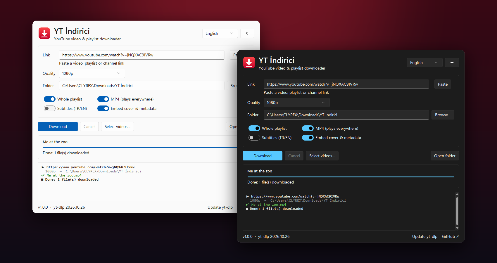
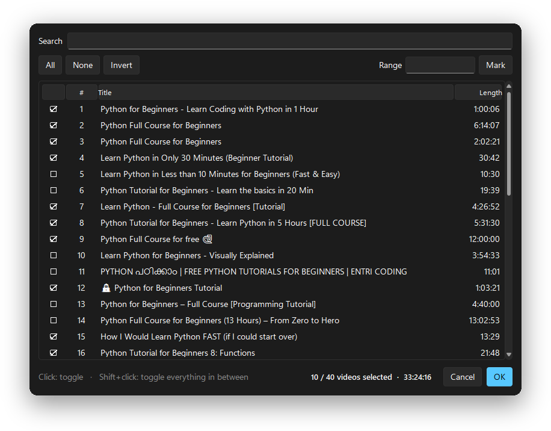

<div align="center">


# YT İndirici

### Download YouTube videos, music and entire playlists — without the sketchy websites.

A tiny, open-source desktop app built on [yt-dlp](https://github.com/yt-dlp/yt-dlp).<br>
Paste a link, pick a quality, hit download. No ads, no pop-ups, no limits, no tracking.

[](https://github.com/Clyrex9/yt-indirici/releases/latest)
[](https://github.com/Clyrex9/yt-indirici/releases)
[](https://github.com/Clyrex9/yt-indirici/actions)
[](LICENSE)


<br>

<a href="https://github.com/Clyrex9/yt-indirici/releases/latest/download/YT-Indirici.exe">
  
</a>

<br><br>

**English** · [Türkçe](README.tr.md)

<br>



</div>

<br>

## ✨ Features

<table>
<tr>
<td width="50%" valign="top">

**🎬 Videos, playlists & channels**<br>
Paste any YouTube link — a single video, a 300-video playlist or a whole channel.

**☑️ Pick exactly what you want**<br>
Only need 12 videos out of 100? Tick them in a searchable list, type a range like `1-10, 15, 20-25`, or shift-click to select a block.

**📺 Any quality**<br>
Best available, 4K, 1440p, 1080p, 720p, 480p or 360p.

**🎵 Audio only**<br>
320 kbps MP3 or M4A — with album art, title and artist embedded.

</td>
<td width="50%" valign="top">

**✅ Plays everywhere**<br>
MP4 mode prefers H.264 + AAC, so files open in any player — no "unsupported codec" surprises with AV1.

**📁 Tidy folders**<br>
Playlists land in their own folder, numbered in order: `Playlist/001 - Title.mp4`.

**⏯️ Resume-friendly**<br>
Re-run a playlist and already-downloaded videos are skipped.

**🌗 Polished UI**<br>
Native Windows 11 look, dark & light themes, English & Turkish, remembers your settings, one-click yt-dlp updates.

</td>
</tr>
</table>

<div align="center">

<br>
<sub>Selecting 10 of 40 videos — with search, ranges and a running total of the length.</sub>
</div>

## 🚀 Getting started

### Option 1 — Download the app (recommended)

1. Download **[YT-Indirici.exe](https://github.com/Clyrex9/yt-indirici/releases/latest/download/YT-Indirici.exe)** and run it. No installation needed.
2. Install **ffmpeg** once — it's needed to merge high-quality video with audio and to convert to MP3:
   ```powershell
   winget install Gyan.FFmpeg
   ```
3. YouTube now requires a **JavaScript runtime** for some formats. If you already have [Node.js](https://nodejs.org), you're set. Otherwise:
   ```powershell
   winget install DenoLand.Deno
   ```

> [!NOTE]
> Windows SmartScreen may warn about an "unrecognized app" because the executable isn't code-signed. Click **More info → Run anyway**. Don't trust it? The [build](.github/workflows/release.yml) runs publicly on GitHub Actions — or run it from source.

### Option 2 — Run from source

Requires [Python 3.10+](https://www.python.org/downloads/).

```bash
git clone https://github.com/Clyrex9/yt-indirici.git
cd yt-indirici
pip install -r requirements.txt
python -m ytindirici
```

On Windows you can also double-click `run.pyw` to start it without a console window.

## 📖 How to use

1. **Paste** a video, playlist or channel link.
2. **Choose** a quality and a download folder.
3. *(Optional)* Click **Select videos…** to download only part of a playlist.
4. Hit **Download**.

> [!TIP]
> Type `ytsearch20:lofi beats` into the link box and click **Select videos…** to pick from the top 20 YouTube search results.

## 🆚 Why not just use a website?

| | YT İndirici | Typical downloader sites |
|---|:---:|:---:|
| Ads, pop-ups, fake "Download" buttons | ❌ None | 😩 Everywhere |
| Whole playlists & channels | ✅ | Rarely |
| Pick specific videos from a playlist | ✅ | ❌ |
| 1080p / 4K with audio | ✅ | Often limited or paid |
| MP3 with cover art & tags | ✅ | Sometimes |
| Length or count limits | ❌ None | Usually |
| Open source | ✅ | ❌ |

## ❓ FAQ

<details>
<summary><b>Downloads suddenly started failing</b></summary>
<br>
YouTube changes things regularly and yt-dlp catches up within days. Click <b>Update yt-dlp</b> at the bottom of the window. If you use the <code>.exe</code>, download the newest release instead.
</details>

<details>
<summary><b>I only get low quality, or video and audio come out as separate files</b></summary>
<br>
ffmpeg isn't installed or isn't on your PATH. Run <code>winget install Gyan.FFmpeg</code> and restart the app.
</details>

<details>
<summary><b>"No supported JavaScript runtime could be found"</b></summary>
<br>
Install <a href="https://nodejs.org">Node.js</a> or Deno (<code>winget install DenoLand.Deno</code>). YouTube requires one to unlock most formats.
</details>

<details>
<summary><b>Age-restricted or members-only videos don't download</b></summary>
<br>
Those require being signed in, which isn't supported yet.
</details>

<details>
<summary><b>Where are my settings stored?</b></summary>
<br>
In <code>%APPDATA%\YT-Indirici\settings.json</code>. Delete it to reset everything.
</details>

<details>
<summary><b>What does "İndirici" mean?</b></summary>
<br>
It's Turkish for <i>downloader</i>. Pronounced roughly "in-dee-ree-jee".
</details>

## 🛠️ Development

```bash
pip install -r requirements.txt
python -m unittest discover -s tests
```

```
ytindirici/
├── app.py          # main window (tkinter + sv-ttk)
├── picker.py       # playlist video picker
├── downloader.py   # yt-dlp wrapper: options, listing, downloading
├── i18n.py         # UI strings (English / Turkish)
├── settings.py     # persisted preferences
└── utils.py
```

Pushing a `v*` tag builds the Windows `.exe` on GitHub Actions and attaches it to a new release.

## 🤝 Contributing

Issues and pull requests are welcome! A few easy ways to help:

- 🌍 **Add a translation** — copy the `"en"` block in [`i18n.py`](ytindirici/i18n.py), translate it, and add your language to `LANGUAGES`.
- 🐛 **Report a bug** — include the link (if public) and the error from the log panel.
- 💡 **Suggest a feature** — open an issue.

## ⚖️ Disclaimer

This tool is intended for personal use, such as saving videos you have the right to download for offline viewing. You are responsible for complying with copyright law and [YouTube's Terms of Service](https://www.youtube.com/t/terms). Please don't redistribute content you don't own.

## 💙 Built with

[yt-dlp](https://github.com/yt-dlp/yt-dlp) — the engine doing all the heavy lifting ·
[Sun Valley ttk theme](https://github.com/rdbende/Sun-Valley-ttk-theme) — the Windows 11 look ·
[FFmpeg](https://ffmpeg.org) — merging & converting

## 📄 License

[MIT](LICENSE) © Clyrex

<div align="center">
<br>
<sub>If this saved you from one more ad-infested website, consider giving it a ⭐</sub>
</div>
