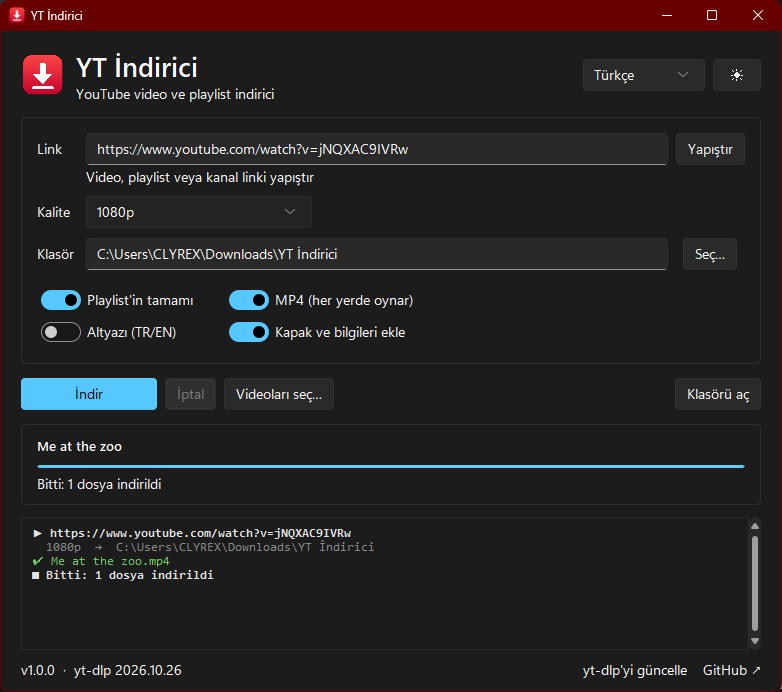
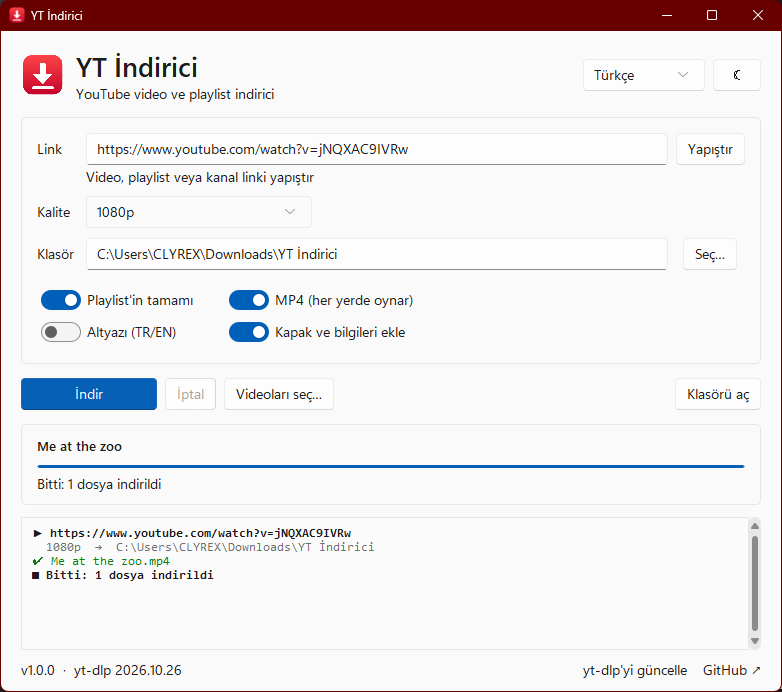
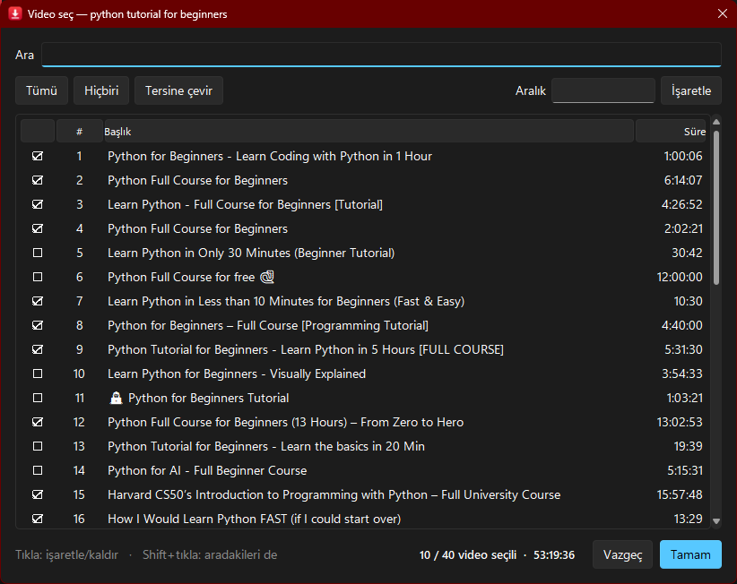
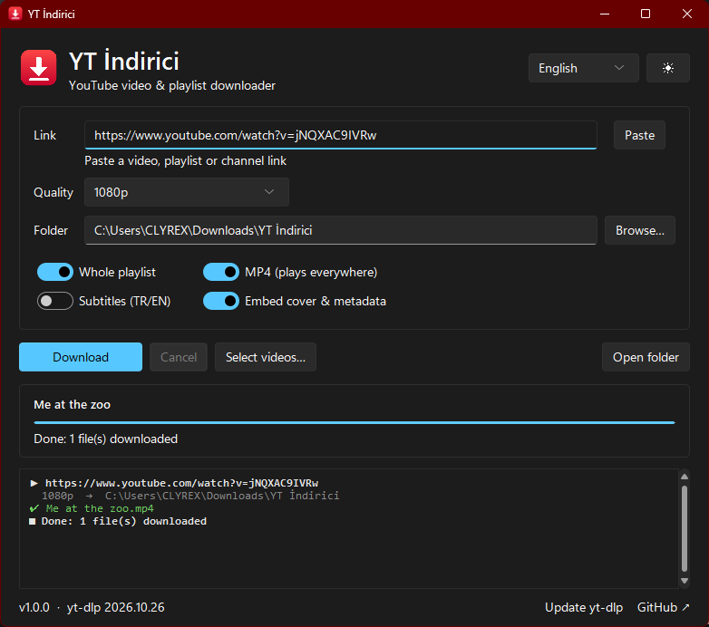
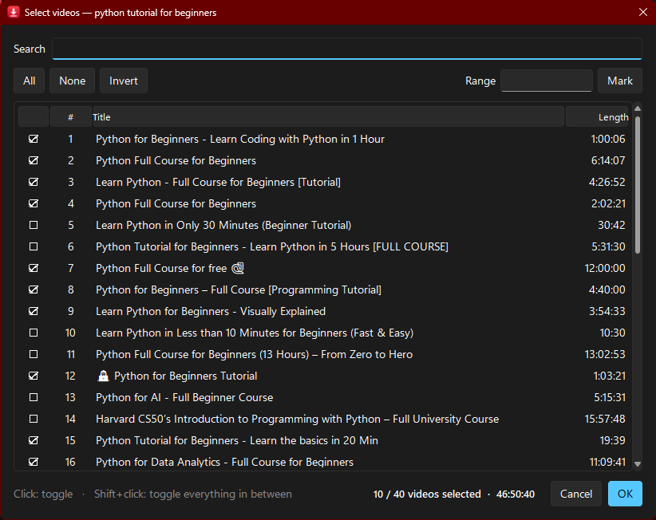

<div align="center">


# YT İndirici

**YouTube'dan video, müzik ve playlist indirmenin en sade yolu.**
Reklam yok, limit yok, site yok — linki yapıştır, kaliteyi seç, indir.

[](https://github.com/Clyrex9/yt-indirici/releases/latest)
[](LICENSE)


[**⬇ İndir (.exe)**](https://github.com/Clyrex9/yt-indirici/releases/latest) · [English](#english)

 

</div>

## Özellikler

- 🎬 **Tek video, playlist veya kanal** — linki yapıştırman yeterli
- ☑️ **Playlist'ten seçerek indir** — 100 videoluk listeden sadece istediklerini işaretle; arama, aralık (`1-10, 15, 20-25`) ve Shift+tık ile toplu seçim
- 📺 **Kalite seçimi** — 4K, 1440p, 1080p, 720p, 480p, 360p veya en iyisi
- 🎵 **Sadece ses** — 320 kbps MP3 ya da M4A, kapak resmi ve şarkı bilgileriyle
- ✅ **Her yerde oynar** — MP4 modunda H.264/AAC tercih edilir; Windows'un kendi oynatıcısında bile açılır
- 📁 **Düzenli klasörler** — playlist'ler kendi klasörüne `001 - Video Adı.mp4` şeklinde sıralı iner
- ⏯️ **Kaldığı yerden devam** — aynı playlist'i tekrar indirince inmiş olanları atlar
- 💬 **Altyazı** — Türkçe/İngilizce altyazıları `.srt` olarak indirir
- 🌗 **Koyu / açık tema**, 🇹🇷 Türkçe / 🇬🇧 İngilizce arayüz, ayarlar hatırlanır
- 🔄 **Tek tıkla yt-dlp güncelleme** — YouTube bir şeyleri değiştirdiğinde

<div align="center">

</div>

## Kurulum

### Seçenek 1 — Hazır .exe (en kolayı)

1. [Releases](https://github.com/Clyrex9/yt-indirici/releases/latest) sayfasından `YT-Indirici.exe` dosyasını indir ve çalıştır.
2. Yüksek kalite ve MP3 için **ffmpeg** gerekli (bir kere kurman yeterli):
   ```powershell
   winget install Gyan.FFmpeg
   ```
3. YouTube artık bazı formatlar için bir JavaScript motoru istiyor. [Node.js](https://nodejs.org) kuruluysa onu kullanır, yoksa:
   ```powershell
   winget install DenoLand.Deno
   ```

> Windows SmartScreen "tanınmayan uygulama" uyarısı verebilir — imzasız açık kaynak uygulamalarda normaldir. *Ek bilgi → Yine de çalıştır.*

### Seçenek 2 — Kaynak koddan

[Python 3.10+](https://www.python.org/downloads/) gerekli.

```bash
git clone https://github.com/Clyrex9/yt-indirici.git
cd yt-indirici
pip install -r requirements.txt
python -m ytindirici
```

Konsol penceresi olmadan açmak için `run.pyw` dosyasına çift tıklayabilirsin.

## Kullanım

1. Video, playlist veya kanal linkini yapıştır.
2. Kaliteyi ve klasörü seç.
3. Playlist'in sadece bir kısmını istiyorsan **Videoları seç…** ile işaretle.
4. **İndir**'e bas.

İpucu: Link kutusuna `ytsearch20:aranacak şey` yazıp **Videoları seç…** dersen YouTube aramasındaki ilk 20 sonuçtan seçebilirsin.

## Sık karşılaşılan sorunlar

| Sorun | Çözüm |
|---|---|
| İndirmeler birden hata vermeye başladı | Alttaki **yt-dlp'yi güncelle**'ye tıkla (exe sürümünde yeni sürümü indir). |
| Sadece düşük kalite iniyor / ses ve görüntü ayrı | ffmpeg kurulu değil: `winget install Gyan.FFmpeg` |
| "No supported JavaScript runtime" | Node.js veya Deno kur (yukarıya bak). |
| Yaş sınırlı / üyelere özel videolar inmiyor | Bunlar giriş gerektirir, şu an desteklenmiyor. |

## Geliştirme

```bash
pip install -r requirements.txt
python -m unittest discover -s tests
```

Proje yapısı:

```
ytindirici/
├── app.py          # ana pencere (tkinter + sv-ttk)
├── picker.py       # playlist video seçme penceresi
├── downloader.py   # yt-dlp sarmalayıcı: ayarlar, listeleme, indirme
├── i18n.py         # arayüz metinleri (TR / EN)
├── settings.py     # ayarların kaydı (%APPDATA%\YT-Indirici)
└── utils.py
```

`v*` etiketi push'landığında GitHub Actions Windows `.exe` dosyasını derleyip Releases'a ekler.

Katkılar memnuniyetle karşılanır — issue açabilir ya da pull request gönderebilirsin. Yeni bir dil eklemek için `i18n.py`'a bir sözlük eklemen yeterli.

## Sorumluluk reddi

Bu araç kişisel kullanım içindir. İndirdiğin içeriklerin telif haklarına ve [YouTube Hizmet Şartları](https://www.youtube.com/t/terms)'na uymak senin sorumluluğundadır. Hakkı sende olmayan içerikleri yeniden yayınlama.

## Teşekkürler

- [yt-dlp](https://github.com/yt-dlp/yt-dlp) — tüm ağır işi yapan motor
- [Sun Valley ttk theme](https://github.com/rdbende/Sun-Valley-ttk-theme) — Windows 11 görünümü
- [FFmpeg](https://ffmpeg.org) — birleştirme ve dönüştürme

---

<a name="english"></a>

## English

**YT İndirici** ("YT Downloader") is a clean desktop app for downloading YouTube videos, music and playlists — no ads, no limits, no sketchy websites. The UI is available in English and Turkish.

<div align="center">
 
</div>

**Features:** single videos, playlists and channels · pick exactly which playlist videos to download (search, ranges like `1-10, 15`, shift+click) · 4K to 360p or best · MP3 (320 kbps) / M4A with cover art and tags · MP4 mode prefers H.264/AAC so files play everywhere · playlists saved to their own folder as `001 - Title.mp4` · skips already-downloaded files · TR/EN subtitles · dark/light theme · one-click yt-dlp update.

**Install:** grab `YT-Indirici.exe` from [Releases](https://github.com/Clyrex9/yt-indirici/releases/latest), or run from source:

```bash
git clone https://github.com/Clyrex9/yt-indirici.git
cd yt-indirici
pip install -r requirements.txt
python -m ytindirici
```

You'll also want **ffmpeg** (`winget install Gyan.FFmpeg`) for high quality and MP3, and a JavaScript runtime — [Node.js](https://nodejs.org) or Deno (`winget install DenoLand.Deno`) — which YouTube now needs for some formats.

**Disclaimer:** for personal use. Respect copyright and YouTube's Terms of Service.

## Lisans / License

[MIT](LICENSE)
