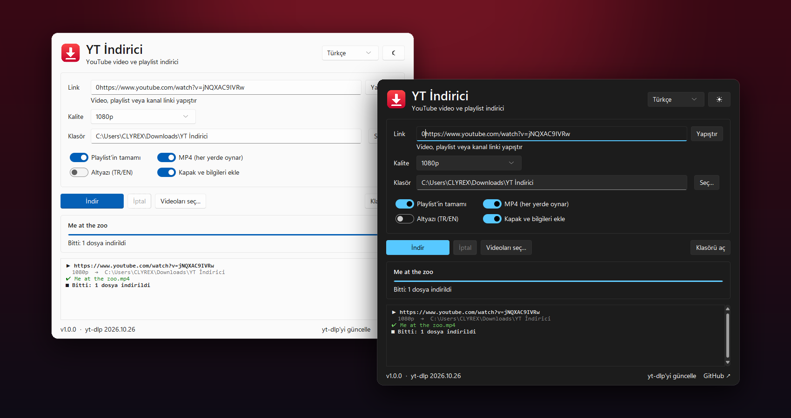
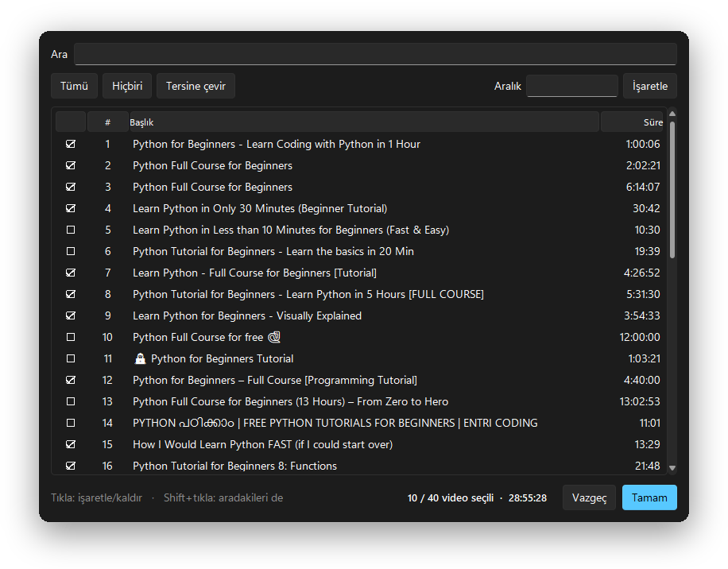

<div align="center">


# YT İndirici

### YouTube'dan video, müzik ve playlist indir — reklamlı sitelerle uğraşmadan.

[yt-dlp](https://github.com/yt-dlp/yt-dlp) üzerine kurulu, küçük ve açık kaynaklı bir masaüstü uygulaması.<br>
Linki yapıştır, kaliteyi seç, indir. Reklam yok, açılır pencere yok, limit yok, takip yok.

[](https://github.com/Clyrex9/yt-indirici/releases/latest)
[](https://github.com/Clyrex9/yt-indirici/releases)
[](https://github.com/Clyrex9/yt-indirici/actions)
[](LICENSE)


<br>

<a href="https://github.com/Clyrex9/yt-indirici/releases/latest/download/YT-Indirici.exe">
  
</a>

<br><br>

[English](README.md) · **Türkçe**

<br>



</div>

<br>

## ✨ Özellikler

<table>
<tr>
<td width="50%" valign="top">

**🎬 Video, playlist ve kanal**<br>
Her türlü YouTube linkini yapıştır: tek video, 300 videoluk playlist ya da koca bir kanal.

**☑️ Sadece istediklerini indir**<br>
100 videodan 12'si mi lazım? Aranabilir listeden işaretle, `1-10, 15, 20-25` gibi aralık yaz ya da Shift+tık ile toplu seç.

**📺 İstediğin kalite**<br>
En iyisi, 4K, 1440p, 1080p, 720p, 480p veya 360p.

**🎵 Sadece ses**<br>
320 kbps MP3 veya M4A — kapak resmi, şarkı adı ve sanatçı bilgisiyle.

</td>
<td width="50%" valign="top">

**✅ Her yerde oynar**<br>
MP4 modu H.264 + AAC'yi tercih eder; dosyalar her oynatıcıda açılır, AV1 yüzünden "desteklenmeyen kodek" sürprizi yaşamazsın.

**📁 Düzenli klasörler**<br>
Playlist'ler kendi klasörüne sıralı iner: `Playlist/001 - Başlık.mp4`.

**⏯️ Kaldığı yerden devam**<br>
Aynı playlist'i tekrar başlatınca inmiş videolar atlanır.

**🌗 Şık arayüz**<br>
Windows 11 görünümü, koyu ve açık tema, Türkçe ve İngilizce, ayarları hatırlar, tek tıkla yt-dlp güncellemesi.

</td>
</tr>
</table>

<div align="center">

<br>
<sub>40 videodan 10'unu seçmek — arama, aralık ve toplam süre göstergesiyle.</sub>
</div>

## 🚀 Kurulum

### Seçenek 1 — Uygulamayı indir (önerilen)

1. **[YT-Indirici.exe](https://github.com/Clyrex9/yt-indirici/releases/latest/download/YT-Indirici.exe)** dosyasını indir ve çalıştır. Kurulum gerekmez.
2. **ffmpeg**'i bir kere kur — yüksek kaliteli görüntüyle sesi birleştirmek ve MP3'e dönüştürmek için gerekli:
   ```powershell
   winget install Gyan.FFmpeg
   ```
3. YouTube artık bazı formatlar için bir **JavaScript motoru** istiyor. [Node.js](https://nodejs.org) kuruluysa sorun yok, değilse:
   ```powershell
   winget install DenoLand.Deno
   ```

> [!NOTE]
> Exe imzalı olmadığı için Windows SmartScreen "tanınmayan uygulama" uyarısı verebilir. **Ek bilgi → Yine de çalıştır**'a tıkla. İçin rahat etmiyorsa: [derleme](.github/workflows/release.yml) GitHub Actions'ta herkese açık şekilde yapılıyor — ya da kaynak koddan çalıştır.

### Seçenek 2 — Kaynak koddan çalıştır

[Python 3.10+](https://www.python.org/downloads/) gerekli.

```bash
git clone https://github.com/Clyrex9/yt-indirici.git
cd yt-indirici
pip install -r requirements.txt
python -m ytindirici
```

Windows'ta konsol penceresi olmadan açmak için `run.pyw` dosyasına çift tıklayabilirsin.

## 📖 Kullanım

1. Video, playlist veya kanal linkini **yapıştır**.
2. Kaliteyi ve klasörü **seç**.
3. *(İsteğe bağlı)* Playlist'in sadece bir kısmı için **Videoları seç…**'e tıkla.
4. **İndir**'e bas.

> [!TIP]
> Link kutusuna `ytsearch20:lofi müzik` yazıp **Videoları seç…** dersen YouTube aramasının ilk 20 sonucundan seçebilirsin.

## 🆚 Neden bir site yerine bu?

| | YT İndirici | Tipik indirme siteleri |
|---|:---:|:---:|
| Reklam, açılır pencere, sahte "İndir" düğmeleri | ❌ Yok | 😩 Her yerde |
| Playlist ve kanalın tamamı | ✅ | Nadiren |
| Playlist'ten belirli videoları seçme | ✅ | ❌ |
| Sesli 1080p / 4K | ✅ | Çoğu zaman kısıtlı ya da ücretli |
| Kapak ve etiketli MP3 | ✅ | Bazen |
| Süre veya adet limiti | ❌ Yok | Genelde var |
| Açık kaynak | ✅ | ❌ |

## ❓ Sık sorulanlar

<details>
<summary><b>İndirmeler birden hata vermeye başladı</b></summary>
<br>
YouTube sık sık bir şeyleri değiştiriyor, yt-dlp de birkaç gün içinde yetişiyor. Pencerenin altındaki <b>yt-dlp'yi güncelle</b>'ye tıkla. <code>.exe</code> kullanıyorsan en yeni sürümü indir.
</details>

<details>
<summary><b>Sadece düşük kalite iniyor ya da görüntü ve ses ayrı dosyalar olarak çıkıyor</b></summary>
<br>
ffmpeg kurulu değil veya PATH'te değil. <code>winget install Gyan.FFmpeg</code> çalıştırıp uygulamayı yeniden başlat.
</details>

<details>
<summary><b>"No supported JavaScript runtime could be found" hatası</b></summary>
<br>
<a href="https://nodejs.org">Node.js</a> veya Deno kur (<code>winget install DenoLand.Deno</code>). YouTube formatların çoğu için bunu istiyor.
</details>

<details>
<summary><b>Yaş sınırlı veya üyelere özel videolar inmiyor</b></summary>
<br>
Bunlar giriş yapmayı gerektiriyor, şu an desteklenmiyor.
</details>

<details>
<summary><b>Ayarlarım nerede saklanıyor?</b></summary>
<br>
<code>%APPDATA%\YT-Indirici\settings.json</code> dosyasında. Silersen her şey sıfırlanır.
</details>

## 🛠️ Geliştirme

```bash
pip install -r requirements.txt
python -m unittest discover -s tests
```

```
ytindirici/
├── app.py          # ana pencere (tkinter + sv-ttk)
├── picker.py       # playlist video seçme penceresi
├── downloader.py   # yt-dlp sarmalayıcı: ayarlar, listeleme, indirme
├── i18n.py         # arayüz metinleri (İngilizce / Türkçe)
├── settings.py     # kalıcı ayarlar
└── utils.py
```

`v*` etiketi push'landığında GitHub Actions Windows `.exe` dosyasını derleyip yeni bir sürüme ekler.

## 🤝 Katkı

Issue ve pull request'ler memnuniyetle karşılanır! Kolayca katkı vermenin birkaç yolu:

- 🌍 **Çeviri ekle** — [`i18n.py`](ytindirici/i18n.py) içindeki `"en"` bloğunu kopyala, çevir ve dilini `LANGUAGES`'a ekle.
- 🐛 **Hata bildir** — linki (herkese açıksa) ve kayıt panelindeki hatayı ekle.
- 💡 **Özellik öner** — bir issue aç.

## ⚖️ Sorumluluk reddi

Bu araç kişisel kullanım içindir; örneğin indirme hakkın olan videoları çevrimdışı izlemek için kaydetmek gibi. Telif hakkı yasalarına ve [YouTube Hizmet Şartları](https://www.youtube.com/t/terms)'na uymak senin sorumluluğundadır. Hakkı sende olmayan içerikleri yeniden yayınlama.

## 💙 Teşekkürler

[yt-dlp](https://github.com/yt-dlp/yt-dlp) — tüm ağır işi yapan motor ·
[Sun Valley ttk theme](https://github.com/rdbende/Sun-Valley-ttk-theme) — Windows 11 görünümü ·
[FFmpeg](https://ffmpeg.org) — birleştirme ve dönüştürme

## 📄 Lisans

[MIT](LICENSE) © Clyrex

<div align="center">
<br>
<sub>Seni bir reklam dolu siteden daha kurtardıysa bir ⭐ bırakmayı düşünebilirsin</sub>
</div>
